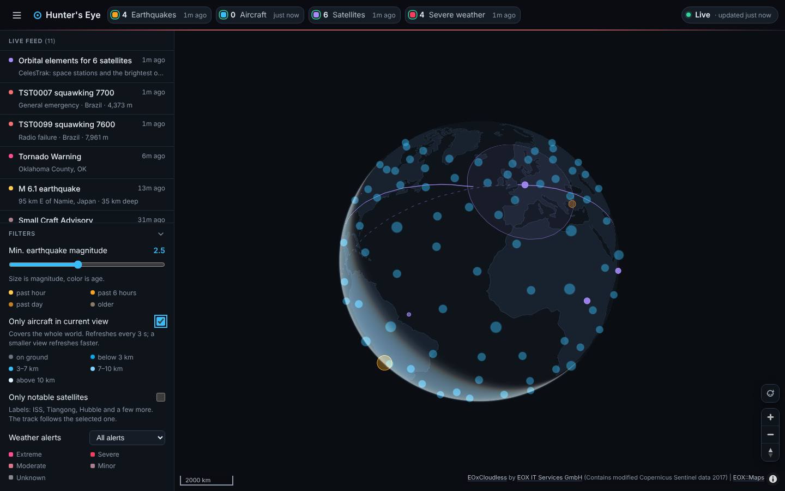

# Hunter's Eye

[](https://github.com/hunterawsome1243/Hunters-Eye/actions/workflows/ci.yml) [](LICENSE)

An open-source intelligence (OSINT) dashboard that fuses four free public data feeds onto one live 3D globe: spin it, tilt it, and zoom from space, where Earth is drawn from satellite imagery, down to street level, where it becomes a real map with roads, water, buildings and labels.

**Live demo:** <https://hunters-eye.onrender.com> (free hosting, so the first visit after a quiet spell takes about a minute to wake up).



Everything is free and keyless, the code is MIT licensed, and new data layers are two small files. See [Build your own](#build-your-own).

| Layer | What you see | Source |
| --- | --- | --- |
| **Earthquakes** | Circles sized by magnitude, colored by age (past hour, 6 hours, day, older) | USGS real-time GeoJSON feed |
| **Aircraft** | Plane icons rotated to heading, colored by altitude, positions estimated between refreshes | OpenSky Network |
| **Satellites** | ISS, Tiangong, Hubble and ~150 bright objects, positions computed live in the browser with satellite.js; the selected satellite's ground track and visibility footprint | CelesTrak |
| **Severe weather** | Active US alerts drawn as shaded areas, colored by severity | US National Weather Service |

Other features:

- A **3D globe** drawn by MapLibre GL JS: drag to spin, right-drag (or two fingers) to tilt, scroll to zoom from orbit to street level. From space the Earth is Sentinel-2 satellite imagery under the vector map's borders and labels; between zoom 9.5 and 12 the imagery fades out and the dark street map takes over, with extruded buildings from zoom 14.5. The globe rotates slowly on its own until you touch it (the button under the zoom controls turns that off; it also stays off under "reduce motion"). Satellite ground tracks wrap around the sphere.
- Click anything on the map (or in the feed) to open a detail panel: magnitude, depth and time for a quake; callsign, altitude, speed and squawk for a plane; name, altitude, speed and orbit for a satellite; full alert text for weather.
- A **live feed** down the side, newest first, mixing all layers: new earthquakes, new weather alerts, aircraft squawking emergency codes (7500/7600/7700), satellite element updates, and any feed failing or recovering.
- A **summary bar** with one chip per layer: on/off toggle, item count, time of the last update and a health dot (green ok, grey loading, amber stale, red failed). Hover a chip for the error message, the next refresh time and the source's notes.
- **Filters**: minimum earthquake magnitude, only aircraft in the current map view, only notable satellites, minimum weather severity.
- Each source refreshes on its own schedule, sized to that source's rate limits. If one feed fails, its chip turns red, the last good data stays on the map, and the other layers keep running.
- If the server can't reach OpenSky or CelesTrak at all, your browser fetches that feed itself and the chip says **via browser**. See [Browser fallback](#browser-fallback).
- Optional **Brief me** button: Claude writes an 80-140 word situation brief of what is on the globe. It appears only when the server has an `ANTHROPIC_API_KEY`; see [Situation brief](#situation-brief-optional).
- Optional **Describe** button on the detail card: click any object on the globe and Claude explains what it is and why it matters, in 60-110 words, and answers follow-up questions about it. Same key, same limits; see [Describe an object](#describe-an-object-optional).
- **Proximity feed**: the feed opens on the things nearest to you, with a distance and direction on every row; the **Live feed** tab is the same list newest first. See [You are here](#you-are-here).
- **You are here**: a crosshair button by the zoom controls places you on the globe from your network address (city accuracy), and every detail card then says how far away the thing is and in which direction. See [You are here](#you-are-here).
- **Watchlist**: rules in the sidebar (a callsign, a place, "Tornado", "M6", or anything within a distance of you) that star matching feed rows as they land and, if you allow it, show a browser notification. Rules stay in your browser.

## Run it

Needs Node.js 22 or newer.

```bash
npm install
npm start
```

Then open <http://localhost:3000>. That is the only command; no API keys are needed. The globe needs a browser with WebGL2 (every current browser; Safari 15 or newer). Without it the page says so and the feed and status keep working.

Optional settings live in `.env` (copy `.env.example`). The most useful one is a free OpenSky API client, which makes aircraft refresh every ~1.5 minutes instead of every ~17. See [Configuration](#configuration).

`npm run dev` restarts the server when you edit server code.

## Build your own

Hunter's Eye is meant to be a starting point. Fork it, rename it, point it at your own data.

1. **Fork** the repository on GitHub (or click **Use this template** if it is shown), then clone your copy and run `npm install && npm start`.
2. **Add a layer.** [`examples/natural-events/`](examples/natural-events/) is a complete, tested layer for NASA's wildfire, volcano and storm feed, with copy-paste steps. Swap its URL and parsing for any feed you like.
3. **Remove what you don't need.** Each feed is one entry in `server/sources/index.js` and one in `public/js/layers/index.js`; delete both to drop it.
4. **Change the look.** Colours and layout live in `public/css/style.css`; the basemap and imagery are environment variables (`BASEMAP_STYLE`, `IMAGERY_TILES`, see [Configuration](#configuration)).
5. **Put it online** with the included Render Blueprint ([Deploy on Render](#deploy-on-render)). Set `USER_AGENT` to your own project name and contact URL.

[CONTRIBUTING.md](CONTRIBUTING.md) covers setup, tests, the two module contracts and the ground rules for adding data sources (keyless by default, inside the provider's limits, secrets on the server, licences checked).

## How it works

```
browser ──/api/status every 5 s──▶  Node server (Express)  ──on each source's own schedule──▶  USGS / OpenSky / CelesTrak / NWS
        ◀─/api/sources/<id> only when that source has new data──┘   (in-memory cache, disk cache for satellites and weather zones)
```

- The **server** (`server/`) polls each upstream API on a fixed schedule and keeps the latest result in memory. Browsers only ever read from that cache, so opening ten tabs does not make ten times the upstream calls, and there are no cross-origin problems. When no browser has asked for anything in 10 minutes, polling pauses, so an idle server uses none of your rate-limit budget. Waking up still respects the previous interval.
- The **browser** (`public/`) polls `/api/status` every 5 seconds. That small response carries every source's health, count and version; the browser downloads a source's data only when its version changes.
- MapLibre GL JS, satellite.js and the app's own modules are served by the local server, so the only third-party requests the page makes are for the map itself: OpenFreeMap's style, vector tiles, fonts and sprites, and EOX's imagery tiles.
- The **globe** (`public/js/globe.js`) starts on a built-in style (a dark sphere with Natural Earth continents from `public/data/`), then fetches the basemap style, adds the projection, sky, imagery and 3D buildings to it (`public/js/globe/style.js`) and swaps it in. Every layer module re-mounts itself after each style load, so a basemap that fails to load leaves the continents in place and the data untouched. NASA's Blue Marble always sits under the Sentinel-2 imagery, so a Sentinel tile that is slow or never arrives shows Blue Marble rather than a bare patch. If enough Sentinel tiles fail outright, the globe switches to Blue Marble alone and says so in the feed.

### Browser fallback

Some hosts can't reach every feed. From Render's Oregon region, OpenSky and CelesTrak both time out; they most likely block Render's shared outbound addresses. So when the server reports aircraft or satellites as failed **and has no data for them**, the browser fetches that feed straight from the provider (`public/js/fallback.js`):

- **Satellites**: the same 2-hour rule as the server. Each group is downloaded at most once per CelesTrak update and kept in the browser's localStorage, so reloading the page doesn't download again. A 403 keeps the cached copy. Without a cache it retries every 10 minutes.
- **Aircraft**: anonymous OpenSky only, because the API client secret must stay on the server. That is 400 credits a day for the viewer's own connection, so a whole-world refresh every ~17 minutes (faster with "only aircraft in current view"). The last request time is shared across tabs, a reload waits at least a minute, and a 429 pauses requests for an hour.
- It stops as soon as the server has data again, and it uses the same parsing and budgeting code as the server (`shared/`).
- It only works when the provider allows requests from other web pages (CORS). CelesTrak does (checked October 2026). OpenSky couldn't be checked from a cloud network because it doesn't answer those at all. If the browser is refused too, the chip stays red and its tooltip says that both the server and the browser failed.

Set `BROWSER_FALLBACK=off` to turn it off.

### Situation brief (optional)

With `ANTHROPIC_API_KEY` set, a **Situation brief** section appears at the top of the sidebar with a **Brief me** button. Pressing it sends the server a compact snapshot of what you see (layer counts, which feeds are healthy, the latest feed entries, the view box) and the server asks Claude Haiku 5.5 for an 80-140 word brief, in plain English, of what matters right now. Nothing is sent until the button is pressed.

- The key lives only on the server (`server/brief.js`); the browser never sees it.
- A brief is about 1,500 tokens in and 250 out, which is roughly **$0.0003** at Haiku 5.5's prices ($0.10 and $0.50 per million tokens). The response shows the cost of each brief.
- Because the page may be public, the server allows one brief every 5 seconds and 20 an hour across all visitors, so the worst case with Haiku 5.5 is about half a cent an hour. `BRIEF_MODEL` picks another model; the per-brief cost is then only shown if that model's prices are added to `PRICE` in `server/brief.js`.

### Describe an object (optional)

With the same `ANTHROPIC_API_KEY`, the detail card that opens when you click a quake, plane, satellite or alert gets a **Describe** button. Pressing it sends the server what the card already shows (the kind, heading, label/value rows, note and link) and the server asks Claude for a 60-110 word plain-English description: what the object is, why it matters, and the general knowledge that helps read the numbers (what a depth or a squawk code means, what kind of satellite it is, what an alert of that type asks people to do). It uses only the record for the object's own facts and never invents operators, routes or outcomes.

- Route: `POST /api/describe` (`server/describe.js`); the key never reaches the browser.
- A description is about 600 tokens in and 150 out, roughly **$0.0001** with Haiku 5.5. It has its own throttle of one every 5 seconds and 20 an hour across all visitors, like the brief.
- A new object clears the last description; nothing is sent until the button is pressed.
- After a description, a one-line box asks a follow-up about the same object. The question goes back with the object and the last answer (only the last one, so a thread never grows), and the answer lands under the question. A follow-up costs about the same as a description and counts against the same throttle.

### You are here

The feed has two tabs. **Proximity feed** (the default) lists the forty things nearest to you, closest first, with the distance and compass direction on each row and the reach of the list in the heading; **Live feed** is the same entries newest first. The tab you pick is remembered in your browser. The proximity feed needs a place to measure from, so on first load it asks the server where you are (below) without moving the globe; if that fails, it shows a **Find me** button and the Live feed takes over until you choose otherwise.

The crosshair button next to the zoom controls asks the server the same question (`GET /api/whereami`, `server/whereami.js`). The server asks a chain of keyless services in turn, [ipwho.is](https://ipwho.is), then [ipapi.co](https://ipapi.co), then [freeipapi.com](https://freeipapi.com), until one answers; each gives city accuracy (tens of km at best, sometimes the wrong city, and a VPN places you at its exit). The answer is cached for an hour per address, and a failure of the whole chain for a minute, so reloads do not hammer the services (ipwho.is rate-limits shared hosting addresses such as Render's). When the server cannot place you at all, pressing the crosshair or the proximity feed's **Find me** falls back to your browser's own location, which asks your permission first and shows no city name. The globe gets an accent marker with your city, flies there, and remembers the place in your browser for a day; pressing the button again removes the marker and forgets it. While the marker is set, every detail card ends with a **From you** row: the distance and compass direction from you to the thing you clicked, so an alert's relative position is one glance away.

- Nothing is looked up until you press the button, and no address is kept beyond the one-hour cache.
- `WHEREAMI_URL` swaps the service (`{ip}` is replaced by the address; empty turns the button off). Any JSON with `latitude`/`longitude` (or `lat`/`lon`) and a `city` works.
- Behind a proxy the visitor's address is in `X-Forwarded-For`: on Render this is on by itself (`RENDER` is set); elsewhere set `TRUST_PROXY=1` (or a hop count).
- Without a key the route answers 404 and the section stays hidden.

## Data sources and limits

All four are free and need no paid plan. Limits below were checked against each provider's documentation in October 2026.

| Source | Endpoint used | Limits | How this app stays inside them |
| --- | --- | --- | --- |
| [USGS Earthquake Hazards](https://earthquake.usgs.gov/earthquakes/feed/v1.0/geojson.php) | `summary/all_day.geojson` | No published rate limit; the file is regenerated every minute. | Fetched once a minute. |
| [OpenSky Network](https://openskynetwork.github.io/opensky-api/rest.html) | `/api/states/all?extended=1` | Anonymous: 400 credits/day. Free account API client: 4,000/day. A request costs 1 credit (box up to 25 sq°), 2 (up to 100), 3 (up to 400) or 4 (larger or global). HTTP 429 when credits run out. Basic auth with username/password no longer works; API clients use OAuth2 client credentials. | After each request the server waits *cost × 24 h ÷ daily credits*, plus 15%. Global view: every ~17 min anonymous, ~1.5 min with an API client. With "only aircraft in current view" the server queries a padded box around your view, which costs fewer credits and so refreshes faster (down to ~4 min anonymous, ~25 s with a client). Honors `X-Rate-Limit-Retry-After-Seconds` on 429. |
| [CelesTrak](https://celestrak.org/NORAD/documentation/gp-data-formats.php) | `gp.php?GROUP=STATIONS&FORMAT=TLE` and `GROUP=VISUAL` | Data updates about every 2 hours. Since March 2026 a repeat download before the next update gets HTTP 403. More than 50 errors (301/403/404) in 2 hours gets your IP firewalled. | Each group is cached on disk (`data/cache/`) and downloaded at most once every 2 hours, including across restarts. A 403 keeps the cached data. After any error the server waits 30 minutes. Positions are computed in the browser every second, so no further requests are needed. |
| [National Weather Service](https://www.weather.gov/documentation/services-web-api) | `/alerts/active?status=actual`, plus `/zones/{type}/{id}` | Requires a `User-Agent`. Limits are not published but described as generous; errors clear within about 5 seconds. | Alerts every 2 minutes. Zone- and county-based alerts arrive without a shape, so their outlines come from the zones endpoint, as the [NWS geolocation guide](https://www.weather.gov/media/documentation/docs/NWS_Geolocation.pdf) recommends. Each zone is downloaded once, simplified and cached on disk; at most 300 per cycle, 4 at a time, most severe alerts first. |
| [OpenFreeMap](https://openfreemap.org/) | `tiles.openfreemap.org/styles/dark` (vector tiles, fonts and sprites from OpenStreetMap data, down to zoom 14 tiles overzoomed to 19) | Free, including commercial use. No API key, no sign-up, no stated request limits; runs on donations. | Loaded directly by the browser and drawn natively by MapLibre GL JS on the globe. Credit line shown on the map. `BASEMAP_STYLE=https://tiles.openfreemap.org/styles/liberty` gives a light map with its own 3D buildings. |
| [EOX Sentinel-2 cloudless](https://s2maps.eu/) | `tiles.maps.eox.at/wmts/1.0.0/s2cloudless_3857/…` (the 2016 mosaic: 10 m satellite imagery, Web Mercator tiles) | Free, no key. The 2016 and 2017 mosaics are CC BY 4.0; 2018 and later are CC BY-NC-SA 4.0. EOX asks for attribution (shown automatically) and may rate-limit heavy use. | Drawn under the vector map from space down to zoom 12, then faded out, so no imagery tile is ever requested above zoom 12. The 2016 layer is the default because it is the global CC BY mosaic. The 2017 layer is CC BY too but only has imagery over Europe, the Middle East and North Africa; elsewhere it returns white land, which is what the first deploy showed. Set `IMAGERY_TILES` to 2018 or later (global) if non-commercial use is fine for you. |
| [NASA GIBS](https://nasa-gibs.github.io/gibs-api-docs/) | `gibs.earthdata.nasa.gov/wmts/epsg3857/best/BlueMarble_ShadedRelief_Bathymetry/…` (zoom 1-7, 611 m/px) | Public domain, no key, no stated limits. | Drawn under the Sentinel-2 layer everywhere, so the whole planet has colour even where EOX tiles are slow. Also the automatic fallback: after 8 failed imagery tiles in a minute the browser switches to Blue Marble and notes it in the feed. The `night` preset in `public/js/globe/style.js` (VIIRS city lights) is one line away. |

**Sources that were swapped or ruled out.**

- **The basemap** first came from CARTO's free Dark Matter tiles, but in 2026 CARTO began requiring an API key and stamps "API key required" across maps without one. OpenFreeMap's dark style replaced it because it needs no key.
- **Street-level satellite imagery** (Esri World Imagery, Mapbox Satellite, MapTiler, Google) needs an API key or a licence, so it is not used. Instead the free Sentinel-2 mosaic covers space to region zooms (~40 m per pixel at zoom 12) and hands over to the vector map, which has the roads, water, parks, labels and building footprints that imagery would be showing at those zooms anyway. That hand-over at zoom 9.5-12 is by design, not a gap.
- **CesiumJS** was considered for the globe. The library is free, but its default imagery, terrain and 3D buildings are gated behind a Cesium ion token, and its keyless street detail is unlabeled vector geometry. MapLibre draws OpenFreeMap's tiles natively, is a quarter of the size, and renders only when something changes.
- **Cross-origin access** to the tile hosts could not be checked from the sandbox this was built in (it blocks them); it is established from their public use by other MapLibre sites and is confirmed by the live smoke run.

## Configuration

Everything is optional. Copy `.env.example` to `.env` and fill in what you need; real environment variables take precedence.

| Variable | Default | Purpose |
| --- | --- | --- |
| `PORT` | `3000` | Port to listen on. |
| `HOST` | `127.0.0.1` | Interface to listen on. Use `0.0.0.0` to open the dashboard to other devices on your network. Everyone then shares one server cache, including the aircraft view box. |
| `USER_AGENT` | `HuntersEye/0.1 (+repo URL)` | Sent to every API. NWS requires one; adding your email lets them contact you. |
| `OPENSKY_CLIENT_ID`, `OPENSKY_CLIENT_SECRET` | empty | A free OpenSky API client (sign in at opensky-network.org, Account page, create an API client). Raises aircraft credits from 400 to 4,000 a day. |
| `EARTHQUAKES_INTERVAL_SEC`, `AIRCRAFT_INTERVAL_SEC`, `WEATHER_INTERVAL_SEC` | safe defaults | Override a refresh interval. The aircraft override skips the credit budgeting, so you can run out of credits. |
| `CACHE_DIR` | `data/cache` | Where satellite elements and weather zone outlines are cached. Empty means memory only. |
| `BASEMAP_STYLE` | OpenFreeMap dark | URL of the MapLibre style the globe's vector map comes from, such as another OpenFreeMap style or your own tile server. |
| `IMAGERY_TILES` | EOX Sentinel-2 cloudless 2016 | `{z}/{x}/{y}` URL of the imagery drawn on the globe from space. Empty turns imagery off (the vector map covers the globe). |
| `IMAGERY_ATTRIBUTION`, `IMAGERY_MAXZOOM` | EOX credit, `12` | The credit line for a custom imagery source, and the deepest zoom its tiles are requested at. |
| `BROWSER_FALLBACK` | on | `off` stops browsers from fetching OpenSky and CelesTrak themselves when the server can't reach them. See [Browser fallback](#browser-fallback). |
| `WHEREAMI_URL` | ipwho.is, ipapi.co, freeipapi.com | The address lookups behind the **You are here** button and the **Proximity feed**: one or more URL templates separated by commas, tried in order, `{ip}` replaced by the address. Empty turns both off. See [You are here](#you-are-here). |
| `TRUST_PROXY` | `1` on Render, else empty | Read the visitor's address from `X-Forwarded-For` behind a proxy. |
| `ANTHROPIC_API_KEY` | empty | Turns on the **Brief me** and **Describe** buttons. See [Situation brief](#situation-brief-optional). `BRIEF_MODEL` picks the model (default `claude-haiku-5-5`). |

Page options: add `?spin=off` to the URL to load with the globe still; the spin button remembers your choice in the browser.

`.env` is in `.gitignore`; never commit real credentials.

## Deploy on Render

The repo includes a `render.yaml` Blueprint. In the Render dashboard choose **New > Blueprint**, pick this repository, and fill in the two OpenSky values when asked. On Render the server listens on `0.0.0.0:$PORT` automatically, and `/healthz` serves health checks without waking the feeds.

Things that work differently on a hosted server:

- **Aircraft and satellites come from your browser.** In October 2026 OpenSky and CelesTrak both timed out from Render's Oregon region, so the [browser fallback](#browser-fallback) fills in and those chips say "via browser". Earthquakes and weather load on the server as usual.
- **An OpenSky API client only helps if the server can reach OpenSky.** Anonymous OpenSky credits are counted per IP address and Render's outbound addresses are shared with other customers, so add a client if your region can reach OpenSky. The browser fallback is always anonymous.
- **Satellites may fail to load on the server after a restart.** The free plan wipes the disk on every restart and spin-down, so the CelesTrak cache is lost. If anyone on the same outbound address downloaded the same group in the last 2 hours, CelesTrak answers 403. A paid instance with a persistent disk set as `CACHE_DIR` avoids this.
- **Free instances sleep.** After 15 minutes with no visitors the service spins down. The first visit afterwards takes about a minute, then each feed loads on its first refresh.
- **Everyone shares one server.** All visitors see the same cache, and the "only aircraft in current view" box is shared too: the last visitor to move the map with the filter on decides the area for everyone.
- **The map tiles and imagery never touch the server.** OpenFreeMap and EOX are fetched by each visitor's browser, so a hosted copy costs the host nothing in bandwidth for the globe itself.
- **Brief me** needs `ANTHROPIC_API_KEY` in the service's environment; the throttle above bounds what a public page can spend.

## Testing

```bash
npm test                    # unit tests: poller, parsers, rate budgeting, caching, geometry
npm run smoke               # end to end against the LIVE feeds
npm run smoke -- --fake     # end to end against local stand-ins (works offline)
npm run smoke -- --fake --server-blocked    # server can't reach OpenSky/CelesTrak; checks the browser fallback
npm run smoke -- --fake --browser-blocked   # ...and the browser is refused too; checks the error message
npm run smoke -- --fake --shots             # also saves docs/globe-space.png, docs/globe-region.png and a phone run
```

GitHub Actions runs `npm test` and `npm run smoke -- --fake` on every push to main and every pull request (`.github/workflows/ci.yml`).

The smoke test starts the server, opens the dashboard in headless Chromium, waits for every source, checks each layer has items, clicks an item in each layer and a plane on the globe, checks that planes cluster from space and separate up close, that the satellite ground track wraps the globe, that the magnitude filter hides circles, that the view filter reaches the server, that "reduce motion" stops the spin, and fails on any browser console error or server warning. It saves a screenshot to `docs/screenshot.png`. It needs a Playwright Chromium once: `npx playwright install chromium` (or set `CHROMIUM_PATH` to an existing Chrome/Chromium). Headless Chromium draws the globe with SwiftShader (software WebGL2), so the run is slow but needs no GPU.

The `--fake` stand-ins (`scripts/fake-upstream.mjs`) mirror each API's documented response shape, and the globe's style and tile hosts are answered locally (the app's own offline style with Natural Earth continents, empty tiles), so you can test the whole app with no network.

## Project layout

```
server/
  index.js            starts the server
  app.js              Express routes: static files, /api/config, /api/status, /api/sources/:id, PUT /api/sources/:id/options, POST /api/brief, POST /api/describe, GET /api/whereami
  brief.js            the Claude-written situation brief: snapshot sanitising, throttle, pricing, the shared route factory
  describe.js         the Claude-written description of one clicked object, and its follow-ups
  whereami.js         the visitor's place from their address (ipwho.is), cached
  lib/poller.js       runs one source on its schedule, caches the result, pauses when idle
  lib/http.js         fetch with User-Agent, timeout, readable errors and retry-after
  lib/geometry.js     polygon simplification for weather outlines
  sources/            one module per data source: earthquakes, aircraft, satellites, weather
shared/               OpenSky and CelesTrak parsing and budgeting, used by the server and the browser fallback
public/
  index.html, css/style.css
  data/land-110m.geojson   Natural Earth continents for the offline/fallback globe (scripts/build-land.mjs)
  js/app.js           status polling, layer wiring, the brief button
  js/globe.js         the MapLibre globe: basemap pipeline, draw-order slots, click ranking, camera, controls
  js/globe/           style.js (projection, sky, imagery, buildings), geo.js (antimeridian-safe geometry), spin.js, icons.js
  js/fallback.js      fetches OpenSky and CelesTrak from the browser when the server can't
  js/layers/          one module per globe layer, matching the server sources
  js/ui/              summary bar, live feed, detail panel, brief, you-are-here marker, watchlist, formatting helpers
scripts/              smoke test, the fake upstream APIs, the land-file builder
examples/             a complete extra layer (NASA EONET natural events) to copy from
test/                 unit tests (node:test)
```

### Adding a data source

1. Write `server/sources/<name>.js` exporting `{ id, name, intervalMs, fetch() }`, where `fetch()` returns `{ data, count }` (optionally `note` and `nextDelayMs`) or throws. Add it to `server/sources/index.js`.
2. Write `public/js/layers/<name>.js` with a default `create(ctx)` that returns the layer object described at the top of `public/js/layers/index.js` (sources and layers are added in `mount()`, which runs after every style load), and add it to the list and the draw order there.

The summary chip, health indicator, feed integration and refresh logic come for free. [`examples/natural-events/`](examples/natural-events/) walks through a complete one.

## What I learned

- **Free is not the same as keyless.** CARTO's basemaps, Esri's imagery and Cesium's default globe content are all "free" and all need a token. The combination that needs none is OpenFreeMap for the vector map, EOX Sentinel-2 cloudless (the global 2016 mosaic is CC BY) for imagery from space, and NASA GIBS as the public-domain safety net.
- **A globe is one world.** On the flat map every layer had code to copy items to the world copy in view and to split lines at the antimeridian. On the globe that all goes away, replaced by one rule: keep consecutive longitudes within 180° of each other and let the tile cutter wrap anything within ±540°. A satellite's full orbit is one line.
- **Let the GPU do the per-frame work.** Dead reckoning 10,000 planes on a canvas every frame was the old hot path. Now the planes are a clustered GeoJSON source: MapLibre clusters them from space, draws one SDF icon tinted per feature, and the app only pushes new positions on a cadence that depends on zoom (never below zoom 3, where the movement is sub-pixel).
- **Styles are documents, not APIs.** Instead of calling `setProjection`, `addLayer` and friends on a live map and hoping the differ keeps them, the app builds the whole style JSON (basemap plus projection, sky, imagery, buildings) with a pure function and swaps it in. Every layer re-mounts itself after each style load, which also makes "the basemap failed to load" a non-event.
- **Ambient animation needs a budget.** The spin is one 1-second camera ease at a time, chained on `moveend`, so the map renders only while easing and stops for the first gesture, a hidden tab, "reduce motion", an open detail panel or a view filter that would refetch on every step.
- **Keep the key on the server, and cap what a stranger can spend.** The Brief me button is one route with a 5-second gap and an hourly cap; the browser never sees the key, and the response says what each press cost.

## License and credits

The code is released under the [MIT License](LICENSE): use it, change it and build on it, commercially or not, as long as the copyright notice stays with it.

The data and map content are not covered by that licence; each keeps its provider's terms, and the app shows the required credit lines on the map:

- Map data © [OpenStreetMap](https://www.openstreetmap.org/copyright) contributors (ODbL), served by [OpenFreeMap](https://openfreemap.org/).
- Imagery: [Sentinel-2 cloudless 2016](https://s2maps.eu/) by EOX IT Services GmbH, CC BY 4.0 (contains modified Copernicus Sentinel data 2016). Later years are CC BY-NC-SA, so check before switching `IMAGERY_TILES`.
- NASA GIBS Blue Marble and Natural Earth continents: public domain.
- Feeds: USGS and the National Weather Service (US government, public domain), the [OpenSky Network](https://opensky-network.org/about/terms-of-use) (check its terms of use before any commercial use) and [CelesTrak](https://celestrak.org/).
- Libraries: [MapLibre GL JS](https://github.com/maplibre/maplibre-gl-js) (BSD-3-Clause), [satellite.js](https://github.com/shashwatak/satellite-js) (MIT), [Express](https://expressjs.com/) (MIT).
